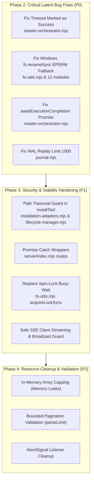

# My Office — Backend Quality & Architectural Reliability Audit
**Audit Date:** November 13, 2026  
**Auditor:** Agent 2 — Backend Quality Engineer  
**Scope:** `server/index.mjs`, `server/control/`, `server/orchestration/`, `server/tools/`, `server/autonomous/`, `server/reliability/`  
**Operational Trial Status:** Active 7-Day Trial (PID 30696) — Monitored in Background. All trial files untouched.

---

## 1. Executive Summary

A comprehensive quality, safety, and reliability audit of the My Office server and its core subsystem modules was conducted. The audit inspected API endpoint contracts, async flow control, process lifecycle, event listeners, socket streaming, atomic persistence, transaction safety, and memory management.

### Key Audit Findings Summary

| Severity | Count | Primary Impact Areas |
| :--- | :---: | :--- |
| **CRITICAL (P0)** | **4** | False task success on timeout, silent disk persistence failure on Windows, premature async returns, journal recovery data loss |
| **HIGH (P1)** | **3** | Arbitrary file write via path traversal in tool installation, unhandled promise rejections crashing runtime, event-loop blocking spin-locks |
| **MEDIUM (P2)** | **5** | Memory leak vectors from unbounded arrays, AbortSignal listener leaks, broken SSE stream broadcasts, synchronous WMI queries, unconstrained API pagination |
| **LOW (P3)** | **3** | Missing defensive type guards, double-write header errors, redundant synchronous disk reads |

---

## 2. Critical Latent Bugs & High-Severity Issues (P0 / P1)

### BUG-01: Falsely Marking Timed-Out Subtasks as `succeeded`
* **File:** [server/orchestration/engine/master-orchestrator.mjs](file:///d:/somehting%20code/my-office/server/orchestration/engine/master-orchestrator.mjs#L305-L336)
* **Severity:** **CRITICAL (P0)**
* **Description:**  
  In `awaitExecutionCompletion()`, the interval poller checks if an execution is terminal or timed out:
  ```javascript
  const isTerminal = exec && ['succeeded', 'failed', 'cancelled'].includes(exec.status);
  const isTimedOut = now() - startTime > maxWaitMs;

  if (isTerminal || isTimedOut) {
    clearInterval(interval);
    subtask.completedAt = now();

    // BUG: If it timed out while status is still 'running', it is marked as 'succeeded'!
    if (exec?.status === 'succeeded' || (exec?.status === 'running' && isTimedOut)) {
      subtask.status = 'succeeded';
      subtask.result = exec?.result || `Completed successfully by ${subtask.assignedProvider}`;
  ```
* **Failure Mode:** Any agent execution that hangs or exceeds 120 seconds (`maxWaitMs`) while running is falsely marked as **SUCCEEDED**, and a bogus handoff record is synthesized claiming successful completion. Dependent subtasks in DAG execution then proceed using incomplete or non-existent outputs.
* **Remediation:**  
  Change condition to mark `isTimedOut` as failed/timed out:
  ```javascript
  if (exec?.status === 'succeeded' && !isTimedOut) {
    subtask.status = 'succeeded';
  } else {
    subtask.status = isTimedOut ? 'timed_out' : (exec?.status === 'cancelled' ? 'cancelled' : 'failed');
    subtask.error = isTimedOut ? `Execution timed out after ${maxWaitMs}ms` : (exec?.error || 'Execution failed');
  }
  ```

---

### BUG-02: Silent Disk Persistence Failures on Windows via `fs.renameSync` `EPERM`
* **Files:**
  - [server/tools/fs-utils.mjs](file:///d:/somehting%20code/my-office/server/tools/fs-utils.mjs#L93-L104) (`atomicWriteJsonSync`)
  - [server/orchestration/engine/master-orchestrator.mjs](file:///d:/somehting%20code/my-office/server/orchestration/engine/master-orchestrator.mjs#L75-L102) (`persist`)
  - [server/control/control-manager.mjs](file:///d:/somehting%20code/my-office/server/control/control-manager.mjs#L47-L63) (`persist`)
  - [server/autonomous/autonomous-scheduler.mjs](file:///d:/somehting%20code/my-office/server/autonomous/autonomous-scheduler.mjs#L70-L86) (`persist`)
  - [server/autonomous/emergency-stop.mjs](file:///d:/somehting%20code/my-office/server/autonomous/emergency-stop.mjs#L86-L106) (`persist`)
  - [server/autonomous/recovery-budget.mjs](file:///d:/somehting%20code/my-office/server/autonomous/recovery-budget.mjs#L64-L80) (`persist`)
  - [server/autonomous/security-guard.mjs](file:///d:/somehting%20code/my-office/server/autonomous/security-guard.mjs#L144-L158) (`persist`)
  - [server/reliability/idempotency.mjs](file:///d:/somehting%20code/my-office/server/reliability/idempotency.mjs#L45-L60) (`persist`)
  - [server/reliability/process-supervisor.mjs](file:///d:/somehting%20code/my-office/server/reliability/process-supervisor.mjs#L43-L57) (`persist`)
  - [server/reliability/reconciliation.mjs](file:///d:/somehting%20code/my-office/server/reliability/reconciliation.mjs#L30-L46) (`persist`)
  - [server/tools/agent-integration-state.mjs](file:///d:/somehting%20code/my-office/server/tools/agent-integration-state.mjs#L10-L24) (`persist`)
  - [server/tools/distribution-engine.mjs](file:///d:/somehting%20code/my-office/server/tools/distribution-engine.mjs#L44-L53) (`persist`)
  - [server/tools/registry.mjs](file:///d:/somehting%20code/my-office/server/tools/registry.mjs#L118-L130) (`persist`)
* **Severity:** **CRITICAL (P0)**
* **Description:**  
  On Windows, `fs.renameSync(tempPath, destination)` throws `EPERM` (Windows `STATUS_ACCESS_DENIED`) when the destination file already exists and is locked or held in memory.
  In `fs-utils.mjs`:
  ```javascript
  try {
    fs.renameSync(tempPath, resolved);
  } catch (err) {
    if (process.platform === 'win32' && err.code === 'EEXIST') { // BUG: On Windows error code is EPERM, not EEXIST!
      fs.copyFileSync(tempPath, resolved);
      ...
    } else {
      throw err;
    }
  }
  ```
  Furthermore, in all other listed modules, `fs.renameSync(tmp, defaultStorePath)` is wrapped in an empty `try { ... } catch { /* In-memory fallback */ }`.
* **Failure Mode:** On Windows, all subsequent updates to state files silently fail to persist to disk. If the server process restarts, all execution updates, emergency stop states, budget tracking, and tool registrations are lost.
* **Remediation:**  
  1. In `fs-utils.mjs`, handle `err.code === 'EEXIST' || err.code === 'EPERM' || err.code === 'EBUSY'`.
  2. Implement a unified, battle-tested `safeAtomicWriteSync(filePath, data)` utility that handles Windows file replacement safely (copy-then-unlink or unlink-then-rename with retry), and adopt it across all persistence modules.

---

### BUG-03: `awaitExecutionCompletion()` Does Not Return a Promise (Fake Await)
* **File:** [server/orchestration/engine/master-orchestrator.mjs](file:///d:/somehting%20code/my-office/server/orchestration/engine/master-orchestrator.mjs#L285-L343)
* **Severity:** **CRITICAL (P0)**
* **Description:**  
  `dispatchSubtaskAsync()` invokes:
  ```javascript
  await awaitExecutionCompletion(masterTask, subtask, dispatchRes.execution.executionId);
  ```
  However, `awaitExecutionCompletion()` creates an asynchronous `setInterval` loop and does **not** return a Promise that awaits completion:
  ```javascript
  async function awaitExecutionCompletion(masterTask, subtask, executionId) {
    const interval = setInterval(() => { ... }, checkInterval);
    interval.unref?.();
    // Returns immediately with resolved Promise<undefined>!
  }
  ```
* **Failure Mode:** `dispatchSubtaskAsync` completes immediately upon task dispatch without waiting for completion. The calling flow assumes the step is done before it even begins execution. Moreover, if an uncaught error throws inside the `setInterval` callback, it crashes the Node process as an unhandled exception.
* **Remediation:**  
  Wrap the `setInterval` in `return new Promise((resolve, reject) => { ... })` and enclose the inner polling body in a `try...catch` block.

---

### BUG-04: WAL Journal Recovery Silently Truncates at 1,000 Events
* **File:** [server/reliability/journal.mjs](file:///d:/somehting%20code/my-office/server/reliability/journal.mjs#L184-L215)
* **Severity:** **CRITICAL (P0)**
* **Description:**  
  `readEvents()` has a default parameter `limit = 1000`:
  ```javascript
  function readEvents({ fromSeq = 0, toSeq = Infinity, limit = 1000 } = {}) { ... }
  ```
  When `replayJournal()` is called during startup recovery:
  ```javascript
  function replayJournal({ fromSeq = 0, toSeq = Infinity, applyFn = null } = {}) {
    const events = readEvents({ fromSeq, toSeq }); // BUG: limit defaults to 1000!
    for (const ev of events) { ... }
  ```
* **Failure Mode:** If the Write-Ahead Log contains more than 1,000 operations, any startup crash replay drops event 1,001 and onwards. System state rebuilt from WAL will be severely corrupted and missing recent actions.
* **Remediation:** In `replayJournal`, pass `{ fromSeq, toSeq, limit: Infinity }`.

---

### BUG-05: Arbitrary File Write via Path Traversal in Tool Installation
* **File:** [server/tools/installation-adapters.mjs](file:///d:/somehting%20code/my-office/server/tools/installation-adapters.mjs#L78-L90) (and lines 158-167, 243-252, 320-329)
* **Severity:** **HIGH (P1 - Security)**
* **Description:**  
  In all four installation adapters (`skill`, `mcp`, `cli`, `composite`), the `files` object from the request body is written directly to disk:
  ```javascript
  for (const [relPath, content] of Object.entries(files)) {
    const dest = path.join(sourceDir, relPath); // BUG: relPath like '../../../../windows/system32/evil.dll'
    fs.mkdirSync(path.dirname(dest), { recursive: true });
    fs.writeFileSync(dest, content, 'utf8');
  ```
* **Failure Mode:** Any caller submitting a tool installation can provide file paths containing `../` traversal sequences to write or overwrite arbitrary files outside the staging directory.
* **Remediation:**  
  Validate every `relPath` using `isSafePath(sourceDir, dest)` before writing:
  ```javascript
  const dest = path.resolve(sourceDir, relPath);
  if (!isSafePath(sourceDir, dest)) {
    throw new Error(`Path traversal rejected: ${relPath}`);
  }
  ```

---

### BUG-06: Unvalidated `tool_id` Directory Traversal & Destructive `rmSync`
* **File:** [server/tools/lifecycle-manager.mjs](file:///d:/somehting%20code/my-office/server/tools/lifecycle-manager.mjs#L267-L268) & [L670-L672](file:///d:/somehting%20code/my-office/server/tools/lifecycle-manager.mjs#L670-L672)
* **Severity:** **HIGH (P1 - Security & Data Integrity)**
* **Description:**  
  `candidateTool.tool_id` is used without alphanumeric/slug format validation:
  ```javascript
  const targetVersionDir = path.join(managedDir, toolId, version);
  // and in uninstall:
  const toolManagedDir = path.join(managedDir, toolId);
  fs.rmSync(toolManagedDir, { recursive: true, force: true });
  ```
* **Failure Mode:** If `tool_id` contains path traversal or resolves to a root directory, `fs.rmSync` recursively deletes arbitrary host directories.
* **Remediation:**  
  Enforce strict tool ID regex `if (!/^[a-zA-Z0-9_-]+$/.test(toolId)) throw new Error('Invalid tool_id format');` and assert `isSafePath(managedDir, toolManagedDir)`.

---

## 3. Async Operations, Error Handling & Process Lifecycle

### 3.1 Unhandled Promise Rejections in `server/index.mjs`
* **File:** [server/index.mjs](file:///d:/somehting%20code/my-office/server/index.mjs#L3472-L3650)
* **Observation:** Multiple POST endpoints invoke `readJson(req).then(async (b) => { ... })` without an attached `.catch(...)`:
  - L3472: `/api/tasks` & `/api/tasks/steer`
  - L3554: `/api/prompt/rewrite`
  - L3563: `/api/chat`
  - L3584: `/api/rc`
  - L3593: `/api/tunnel/domain`
  - L3600: `/api/tunnel`
  - L3611: `/api/phone`
  - L3622: `/api/sys/auto`
  - L3633: `/api/sys/action`
  - L3649: `/api/panel/answer`
  - L3709: `/api/accounts/*`
  - L3759: `/api/ai/*`
* **Risk:** In Node.js 16+, unhandled promise rejections terminate the process with exit code 1. Any unexpected error in these async handlers crashes the server and the live background trial.
* **Remediation:** Wrap route handlers in a standardized `safeAsync(async (req, res) => { ... })` wrapper with universal error catching.

### 3.2 Missing Process-Level Safety Handlers
* **File:** [server/index.mjs](file:///d:/somehting%20code/my-office/server/index.mjs#L4340-L4350)
* **Observation:** There are no global handlers for:
  - `process.on('uncaughtException', (err) => ...)`
  - `process.on('unhandledRejection', (reason, promise) => ...)`
  - `server.on('error', (err) => ...)`
  - `server.on('clientError', (err, socket) => ...)`
* **Risk:** Uncaught network socket exceptions or promise rejections immediately crash the entire backend.

### 3.3 `ERR_HTTP_HEADERS_SENT` in Catch Blocks
* **File:** [server/index.mjs](file:///d:/somehting%20code/my-office/server/index.mjs#L3354-L3368)
* **Observation:** Handlers delegate to sub-routers with:
  ```javascript
  handleToolDiscoveryRoutes(...).then(async () => { ... }).catch((err) => json(res, 500, { ok: false, error: err.message }));
  ```
  If headers were partially sent before the error occurred, `json()` calls `res.writeHead()`, throwing `ERR_HTTP_HEADERS_SENT`.
* **Remediation:** In `json(res, code, obj)`, add guard `if (res.writableEnded || res.headersSent) return;`.

---

## 4. Event Listeners, Socket Connections & SSE Health

### 4.1 Server-Sent Events `/stream` Socket Errors
* **File:** [server/index.mjs](file:///d:/somehting%20code/my-office/server/index.mjs#L3975-L3985)
* **Observation:**
  ```javascript
  if (url.pathname === '/stream') {
    res.writeHead(200, { 'Content-Type': 'text/event-stream', ... });
    const client = { res };
    clients.add(client);
    const ping = setInterval(() => res.write(': ping\n\n'), 20_000);
    req.on('close', () => { clearInterval(ping); clients.delete(client); });
  ```
  `res.on('error', ...)` is not attached. If the TCP socket resets abnormally before the HTTP `req` emits `'close'`, `res.write` can emit an unhandled socket error.

### 4.2 Cascading Broadcast Failure on Stale Sockets
* **File:** [server/index.mjs](file:///d:/somehting%20code/my-office/server/index.mjs#L638-L650)
* **Observation:**
  ```javascript
  function send(res, obj) { res.write(`data: ${JSON.stringify(obj)}\n\n`); }
  function broadcast(obj) {
    for (const c of clients) send(c.res, obj);
  ```
  If a single client connection errors or has closed, `res.write()` throws synchronously, aborting the loop and preventing the remaining clients from receiving notifications.
* **Remediation:** Wrap `res.write` in a `try...catch` and verify `if (!c.res.writableEnded && !c.res.destroyed)`.

### 4.3 AbortSignal Event Listener Leak
* **File:** [server/tools/execution-runner.mjs](file:///d:/somehting%20code/my-office/server/tools/execution-runner.mjs#L246-L255)
* **Observation:**
  ```javascript
  if (signal) {
    signal.addEventListener('abort', () => {
      killed = true;
      try { child.kill('SIGKILL'); } catch {}
    });
  }
  ```
  The listener added to `signal` is never removed on process `close` or `error`. If an AbortSignal is shared across executions, it leaks listener closures indefinitely.
* **Remediation:** Add `signal.removeEventListener('abort', abortHandler)` in `child.on('close')` and `child.on('error')`.

---

## 5. Concurrency, Race Conditions & Event-Loop Blockers

### 5.1 Synchronous 3-Second Spin-Lock in `acquireLockSync`
* **File:** [server/tools/fs-utils.mjs](file:///d:/somehting%20code/my-office/server/tools/fs-utils.mjs#L132-L136)
* **Observation:**
  ```javascript
  // brief spin wait
  const sleepUntil = Date.now() + 25;
  while (Date.now() < sleepUntil) {}
  ```
  If a file lock is held, `acquireLockSync` enters a busy-wait spin-loop for up to 3,000ms. Because Node.js is single-threaded, this **completely freezes the entire event loop**: no HTTP requests can be served, SSE pings stop, and trial watchdogs stall.
* **Remediation:** Replace synchronous busy-waiting with asynchronous lock acquisition using `setTimeout` or file-locking libraries.

### 5.2 Synchronous WMI Process Queries Blocking Event Loop
* **File:** [server/reliability/process-supervisor.mjs](file:///d:/somehting%20code/my-office/server/reliability/process-supervisor.mjs#L75-L77)
* **Observation:**
  ```javascript
  const cmd = `powershell -NoProfile -Command "Get-CimInstance Win32_Process -Filter \\"ProcessId = ${pid}\\" ... "`;
  const output = execSync(cmd, { encoding: 'utf8', timeout: 3000, stdio: ['pipe', 'pipe', 'ignore'] }).trim();
  ```
  On Windows, spawning PowerShell synchronously takes 500ms–1500ms. When `inspectOsProcess()` is called during process termination or reconciliation sweeps, it halts server request handling for 1+ seconds per query.
* **Remediation:** Make process inspection asynchronous (`execFile` instead of `execSync`) with process cache caching.

### 5.3 Non-Atomic WAL Backup Snapshot Copy
* **File:** [server/reliability/backup-manager.mjs](file:///d:/somehting%20code/my-office/server/reliability/backup-manager.mjs#L162-L166)
* **Observation:** `fs.copyFileSync(srcPath, destPath)` copies the active Write-Ahead Log while the journal file descriptor is actively open and appending records. This can produce torn WAL records in the backup snapshot.

---

## 6. Memory Leak Vectors Across Subsystems

The following in-memory arrays and maps grow monotonically without bound during long-running operations:

1. **Recovery Budget History:**  
   [server/autonomous/recovery-budget.mjs:202](file:///d:/somehting%20code/my-office/server/autonomous/recovery-budget.mjs#L202): `history.push(...)` appends on every usage increment. While `history.slice(-100)` is saved to disk, the in-memory `history` array is never trimmed.
2. **Emergency Stop Event Log:**  
   [server/autonomous/emergency-stop.mjs:117](file:///d:/somehting%20code/my-office/server/autonomous/emergency-stop.mjs#L117): `eventLog.push(entry)` continuously appends without an in-memory bound.
3. **Security Audit & Violations:**  
   [server/autonomous/security-guard.mjs:134, 137](file:///d:/somehting%20code/my-office/server/autonomous/security-guard.mjs#L134): `auditTrail` and `violations` arrays append indefinitely.
4. **Autonomous Scheduler Interventions:**  
   [server/autonomous/autonomous-scheduler.mjs:396](file:///d:/somehting%20code/my-office/server/autonomous/autonomous-scheduler.mjs#L396): `interventions` and `remediationHistory` grow without in-memory caps.
5. **Process Supervisor Registry:**  
   [server/reliability/process-supervisor.mjs:151](file:///d:/somehting%20code/my-office/server/reliability/process-supervisor.mjs#L151): The `processes` Map stores terminated execution records forever.

* **Remediation:** Apply an in-memory sliding window cap (e.g., `if (arr.length > 500) arr.splice(0, arr.length - 250)`) across all tracking data structures.

---

## 7. API Route Validation & Defense-in-Depth

### 7.1 Unchecked `parseInt(limit)` Causing `NaN` Slicing
* **Files:**
  - `server/control/control-api.mjs:57, 142`
  - `server/orchestration/orchestration-api.mjs:112`
  - `server/orchestration/engine/master-orchestration-api.mjs:36`
  - `server/orchestration/qa/qa-api.mjs:40, 108`
  - `server/autonomous/autonomous-api.mjs:98, 312`
  - `server/reliability/reliability-api.mjs:76, 97`
* **Observation:** `parseInt(url.searchParams.get('limit') || '50', 10)` returns `NaN` when non-numeric strings are supplied (e.g. `?limit=foo`). In JavaScript, `array.slice(0, NaN)` evaluates to `array.slice(0, 0)`, returning an empty array `[]` silently. Furthermore, an excessively high limit (e.g., `1000000`) is unrestricted.
* **Remediation:** Introduce a helper `parseLimit(val, defaultVal = 50, maxVal = 200)`:
  ```javascript
  const n = parseInt(val, 10);
  return Number.isFinite(n) && n > 0 ? Math.min(n, maxVal) : defaultVal;
  ```

---

## 8. Prioritized Remediation Roadmap



### Safety Rules for Next Phases
1. **Zero Downtime:** Operational Trial 7-day is running live (PID 30696). Server must not be killed or restarted.
2. **Untouched Trial Modules:** `trialStartAt`, `data/trial-monitor/`, `reports/operational-trial/`, and trial monitor logic must remain strictly untouched.
3. **Regression Testing:** Before landing any fixes in Phase 2/3, all 559 unit tests (`npm test`), typecheck, and build must be independently verified by QA.

---
*Report prepared and submitted to `@coordinator`.*
