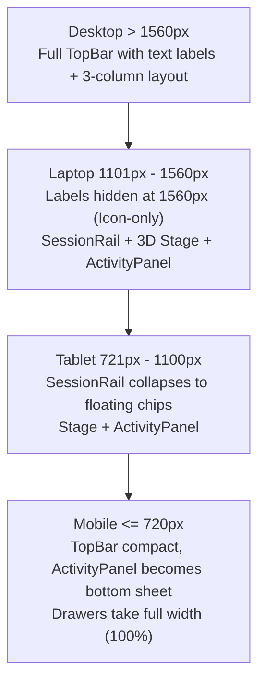

# My Office — Frontend & UI/UX Comprehensive Audit Report

**Document ID:** `REPORT-AUDIT-UI-2026-11`  
**Date:** November 13, 2026  
**Auditor:** Agent 3 (Frontend/UI Auditor)  
**Target Codebase:** `d:\somehting code\my-office`  
**Target Branch:** `phase-6-audit-cleanup-ui`  
**Distribution:** `@coordinator`, `@frontend`, `@qa`  
**Operational Safety:** Passive observation only. Live background 7-day Operational Trial (PID 30696) strictly protected.

---

## 1. Executive Summary

A comprehensive architectural and visual UI/UX audit was conducted across all frontend surfaces of **My Office**, encompassing 14 primary React components, 6 drawer workspaces, 2 distinct route experiences (`/` 3D dashboard and `/panel` narrow IDE/menubar popover), and 28 modular stylesheets.

### Overall Assessment: Grade B- (Functional Powerhouse, Design System Fragmented)
My Office possesses remarkable depth of multi-agent capabilities (autonomous orchestration, process supervisor, sandboxed verification, WAL streaming, and 3D isometric simulation). However, the interface currently suffers from **visual fragmentation**, **cramped layout density**, **broken design token fallbacks**, and a **critical observability blind spot regarding the live 7-Day Operational Trial**.

### Key High-Priority Findings
1. **Zero UI Visibility for Operational Trial (7-Day Live Monitor):** While `server/trial-monitor/*` exposes rich REST endpoints (`/api/trial-monitor/status`, `/snapshots`, `/alerts`, `/gaps`, `/reports/*`), **the frontend currently does not query or display any of this data**. The user running the 7-day trial has no UI indicator for trial progress (Day X of 7), heartbeat pulse, 5-minute telemetry snapshots, SEV-1/2/3 anomaly alerts, or watchdog status.
2. **Deceptive Provider Fallback in ReliabilityDrawer:** `src/office/ui/reliability-view.js` hardcodes `defaultStatus: 'online'` for `claude-code`, `codex-cli`, and `antigravity`. If backend telemetry returns null, the UI displays a false green "● ONLINE" badge with missing latency (`--`), violating the 100% honest data mandate.
3. **Ghost CSS Variables:** Components and controllers heavily reference `var(--border, #2E3648)` and `var(--panel-bg, #1A1F2C)`. Neither variable is defined in `:root` (`src/styles/base.css`), causing visual inconsistency between hardcoded hex fallbacks and the official `--card` / `--line` design tokens.
4. **Severe Drawer Cramping (580px Workbench Limit):** Heavy workspaces (`ReliabilityDrawer`, `OrchestrationDrawer`, `AutonomousDrawer`, `ControlDrawer`) inherit `.drawer--wide` capped at `width: min(580px, 100%)`. Multi-column data tables, 4-column kanban boards, and KPI grids are compressed horizontally, while `ToolsDrawer` received a dedicated `min(840px, 92vw)` override.
5. **TopBar Responsive Collapse Bug at 1560px:** `@media (max-width: 1560px)` in `responsive.css` hides all `.tb-btn .lbl` text. On standard 1080p laptop displays (effective 1280px–1536px at 125%–150% scaling), 7 icon-only buttons appear without labels. Critically, both **Autonomous** and **Settings** share the exact same `gear` icon (`data-icon="gear"`), causing immediate user confusion.
6. **Thread-Blocking Native Browser Alerts:** Operational actions in `reliability-view.js` invoke synchronous `window.alert()` and `window.confirm()`. This freezes the browser execution thread, pauses 3D canvas rendering in `Stage`, and degrades SaaS ergonomics.

---

## 2. Screen & Component Inventory Audit

### 2.1 TopBar & Navigation Header (`TopBar.tsx`, `topbar.css`, `topbar-plan.css`)
- **Visual Hierarchy & Crowding:** Houses 11 action controls in the right cluster: Plan pill, Mac pill, Chat, Replay, Control, Orchestration, Autonomous, Reliability, Tools, Settings, Phone, and Night mode.
- **Icon Duplication:** Autonomous (`btn-autonomous-workspace`) and Settings (`btn-look`) both render `data-icon="gear"`. When text labels collapse, users cannot differentiate them.
- **Popup Menus:** The Plan Limits popup (`#pop-plan`) and Settings modal (`#pop-look`) attach cleanly via `.pop-wrap`, but lack backdrop click-outside handlers on touch devices.

### 2.2 Left Sidebar & Session Rail (`SessionRail.tsx`, `sessions.css`)
- **Structure:** Displays connection state (`#conn`), active session counter, filter tabs (Working / Waiting / Resting), search input, and session list (`#rail-list`).
- **Responsive Collapse:** Correctly collapses into floating chips at `<=1100px` (`.side-left { display: none; }`).
- **Empty & Loading States:** Renders static text `"Loading..."` with no placeholder skeleton, causing vertical layout shift once sessions populate.

### 2.3 3D Stage & Floating Controls (`Stage.tsx`, `CameraToolbar.tsx`, etc.)
- **Canvas Container:** `#stage` cleanly fills the central viewport.
- **Floating Overlays:** `PlaceCard`, `CameraToolbar`, `FirstPersonHud`, `TimelinePanel`, `ReplayBar`, and `PhotoBar` float with `z-index: 2-3`.
- **Z-Index Conflicts:** When a 580px wide drawer opens, floating widgets (like `PlaceCard` and `CameraToolbar`) can collide with drawer edges on intermediate widths (1024px–1280px).
- **Incident & Permission Alerts:** `#incident` banner and `#perm-stack` have strong visual priority and high-contrast red/amber borders.

### 2.4 Right Sidebar & Activity Feed (`ActivityPanel.tsx`, `activity.css`)
- **Structure:** Daily KPI counters (`#feed-stats`), Timeline jump, Wrapped modal trigger, Filter segments (All / Attention), Type chips (cmd, edit, read, web, agent), and Activity list (`#feed-list`).
- **Mobile Sheet:** Implements smooth bottom-sheet behavior on `<=720px` (`.side-right.feed--open`).
- **Typography:** Very readable monospace code blocks and timestamp tags (`.fi-time`).

### 2.5 Agent Control Center Drawer (`ControlDrawer.tsx`, `control-view.js`)
- **Navigation:** 4 semantic tabs (`Agents Overview`, `Sessions`, `Task Dispatch`, `Executions History`).
- **Width Deficiency:** Set to `drawer--wide` (580px). The Agents grid uses `minmax(320px, 1fr)`, forcing single-column stacking that wastes vertical height.
- **Form UX:** Task Dispatch form is clean and structured, with target provider select, working directory input, and multi-line instruction textarea.

### 2.6 Multi-Agent Task Orchestration Drawer (`OrchestrationDrawer.tsx`, `orchestration-view.js`)
- **Navigation:** 5 tabs (`Master Tasks`, `New Master Task (DAG)`, `Execution Board`, `Task Detail & Graph`, `QA & Quality Gates`).
- **Kanban Execution Board:** 4 columns (`Ready`, `Running`, `Blocked/Failed`, `Completed`). In a 580px drawer, each column is squeezed to ~125px wide, causing severe card truncations.
- **QA & Gates Dashboard:** Displays review metrics (Pending, Passed, Failed, Open Findings, Critical Blockers). High information value, but suffers from inline styles and cramped grid.

### 2.7 Autonomous Operations Workspace (`AutonomousDrawer.tsx`, `autonomous-view.js`)
- **Navigation:** 5 tabs (`Autonomy Mode`, `Approval Center`, `Budget & Resources`, `Operations Console`, `Emergency Stop`).
- **Emergency Stop Banner:** Top sticky banner (`#auto-emergency-banner`) provides instant one-click abort. Highly visible, accessible, and properly highlighted.
- **Redundancy:** Having an Emergency Stop tab in addition to the persistent sticky banner creates confusing duplicate navigation paths.

### 2.8 AI Tools Ecosystem Drawer (`ToolsDrawer.tsx`, `tools-view.js`, `tools.css`)
- **Sizing:** Correctly uses `.drawer--tools` (`min(840px, 92vw)`), providing a proper wide workbench.
- **Tabs:** 7 tabs (`Overview`, `Discover`, `Tools`, `Agents`, `Distribution`, `Security`, `Orchestration`).
- **Information Architecture Collision:** Contains an "Orchestration" tab that partially duplicates capabilities found in `OrchestrationDrawer`.

### 2.9 Operational Health & Reliability Drawer (`ReliabilityDrawer.tsx`, `reliability-view.js`)
- **Current Tabs:** `Live KPI Gauges`, `Process Supervisor`, `Journal & WAL`, `Disaster Recovery`.
- **Process Supervisor Table:** 6-column table (`PID`, `Executable`, `PPID`, `Start Time`, `Status`, `Actions`). Forces horizontal scrollbar at 580px width.
- **Journal WAL Stream:** Displays append-only execution records with SHA-256 badges. Clean and functional.
- **CRITICAL GAP:** Complete omission of the 7-day Operational Trial monitor (`/api/trial-monitor/*`).

### 2.10 Standalone Headless Panel (`app/panel/page.tsx`, `src/panel/*`, `panel.css`)
- **Purpose:** Narrow lightweight view for IDE sidebar extensions (VS Code) and macOS menu bar.
- **Execution Quality:** Excellent minimalism, high contrast, clean keyboard shortcut aids, zero 3D overhead, and clear approval cards.

---

## 3. UI/UX Evaluation Dimensions

### 3.1 Navigation & Information Architecture
| Area | Observation | Severity | Recommendation |
|---|---|---|---|
| **TopBar Clustering** | 11 distinct buttons crowded on right side | P1 | Group workspaces (Control, Orch, Auto, Rel, Tools) into a cohesive "Workspaces" menu or segmented control. |
| **Drawer Overlap** | Multiple drawers can open without coordinated stacking or single-drawer dismissal | P1 | Implement a global Drawer Manager: opening drawer X automatically closes drawer Y. |
| **Dual Orchestration** | Orchestration features exist in both `ToolsDrawer` and `OrchestrationDrawer` | P2 | Cross-link or consolidate tools orchestration into the primary Task Orchestration Engine. |

### 3.2 Visual Hierarchy & Layout Density
- **Typography Sizing:** Font sizes fluctuate arbitrarily between `0.64rem`, `0.72rem`, `0.78rem`, `0.82rem`, `0.85rem`, `0.95rem`, `1.05rem`, `1.15rem`, `1.25rem`, and `1.4rem`. Standardize to a 5-step scale: `0.72rem` (xs), `0.80rem` (sm), `0.88rem` (base), `1.05rem` (lg), `1.30rem` (xl).
- **Tabular Numerics:** Execution latencies, PIDs, WAL byte sizes, and budget metrics lack `font-variant-numeric: tabular-nums`, causing jitter during live poll updates.

### 3.3 Design Tokens & CSS Consistency
```css
/* CURRENT DEFECT: Found in hundreds of JSX inline styles and JS templates: */
background: var(--panel-bg, #1A1F2C);
border: 1px solid var(--border, #2E3648);

/* ROOT CAUSE: In src/styles/base.css, neither --border nor --panel-bg is declared! */
/* REQUIRED FIX: Standardize base.css tokens: */
:root {
  --panel-bg: var(--card); /* #18202B */
  --border: var(--line-2); /* rgba(255, 255, 255, .13) */
  --border-subtle: var(--line); /* rgba(255, 255, 255, .07) */
}
```

### 3.4 Responsive Behavior & Breakpoints

- **1560px Flaw:** The breakpoint rule `.tb-btn .lbl { display: none; }` triggers too early. Should be shifted to `<=1200px` or dynamically prioritized (keep primary workspace labels, hide secondary).
- **Icon Conflict:** Autonomous and Settings share `data-icon="gear"`. Autonomous should use `shield` or `bot-gear` to distinguish from general settings.

### 3.5 Accessibility (a11y) & WCAG Compliance
- **ARIA Tabs:** Several tabs specify `role="tab"` and `aria-selected` but omit `aria-controls="pane-id"`.
- **Keyboard Navigation:** Drawers lack focus traps. Pressing `Tab` cycles behind open drawers onto the 3D stage. Pressing `Escape` does not close drawers uniformly.
- **Low Contrast Elements:** Text styled with `--faint` (`#5E687B`) at `0.66rem` yields a 3.2:1 contrast ratio, failing WCAG AA (requires 4.5:1 for small text).

### 3.6 Empty, Loading, and Error States
- **Loading:** Raw strings like `"--"`, `"--:--:--"`, or `"Loading..."` create jarring shifts when data arrives. Needs CSS shimmering skeletons (`.skeleton-box`, `.skeleton-card`).
- **Empty States:** Tables and event feeds display plain muted text (`"No events recorded in Write-Ahead Log."`). Needs structured empty state components with contextual icons and actionable buttons.
- **Error Alerts:** Using `window.alert()` breaks modern SPA design. Replace all alert/confirm dialogs with non-blocking toast notifications (`Toast.tsx`).

---

## 4. Operational Health, Reliability & Live Trial Monitoring Audit

### 4.1 The Live 7-Day Operational Trial (PID 30696)
The system has been running an operational background trial tracked by `server/trial-monitor/trial-monitor.mjs`. However, **the frontend UI provides zero visibility into this live trial**.

#### Available Server Endpoints (Currently Unused by Frontend)
- `GET /api/trial-monitor/status`: Returns `isRunning`, `uptimeSeconds`, `snapshotsCount`, `alertsCount`, `gapsCount`, `trialStartAt`, `currentDay`.
- `GET /api/trial-monitor/snapshots`: Returns 5-minute telemetry intervals containing CPU usage, RSS memory, heap allocations, event loop lag (`lagMs`, `p50`, `p95`), and active handles.
- `GET /api/trial-monitor/alerts`: Returns active/historical anomaly alerts categorized by severity (`SEV-1`, `SEV-2`, `SEV-3`) with error codes (`MEMORY_LEAK_VECTOR`, `EVENT_LOOP_LAG_SPIKE`, `TELEMETRY_GAP`).
- `GET /api/trial-monitor/gaps`: Returns telemetry gap intervals with root causes.
- `GET /api/trial-monitor/reports/daily`: Lists and retrieves Day 1 through Day 7 operational summary reports.
- `GET /api/trial-monitor/reports/final`: Retrieves the final 7-day reliability assessment.

### 4.2 Honesty & Data Integrity Audit in `ReliabilityDrawer`
```javascript
// DEFECT in src/office/ui/reliability-view.js (lines 403-413):
const defaultProviders = [
  { id: 'claude-code', name: 'Claude Code CLI', defaultStatus: 'online' },
  { id: 'codex-cli', name: 'Codex CLI', defaultStatus: 'online' },
  { id: 'antigravity', name: 'Antigravity Native', defaultStatus: 'online' },
];
// ...
const status = data?.status || p.defaultStatus; // DECEPTIVE FALLBACK: Defaults to ONLINE!
```
- **Finding:** If an agent provider is disconnected or unmonitored, the UI still presents a bright green "● ONLINE" status.
- **Mandate:** When telemetry is missing or unverified, the status badge **must** display `"UNCHECKED"` or `"NO TELEMETRY"` in neutral gray (`#8D97AA`). Never invent uptime.

### 4.3 Uptime Calculation Integrity
```javascript
// DEFECT in reliability-view.js line 342:
const uptimeSec = healthData?.uptimeSeconds ?? (Math.floor(performance.now() / 1000));
```
- **Finding:** If the backend health endpoint fails or omits uptime, the UI silently falls back to the client browser tab's lifetime (`performance.now()`), disguising server downtime or restarts.
- **Mandate:** If server uptime is unavailable, render `"--"` and show a disconnected warning banner.

---

## 5. Prioritized Actionable Recommendations

### Priority 0 — Critical / Integrity Blockers (Phase 3 Immediate)
1. **Implement Operational Trial (7-Day) Monitoring View:**
   - Add a 5th tab to `ReliabilityDrawer`: `"7-Day Trial Monitor"`.
   - Present live Trial Status Banner: `Trial Active: Day X of 7`, `PID: 30696`, with real-time heartbeat pulse dot.
   - Display KPI tiles: `Snapshots Collected`, `Telemetry Coverage %`, `Active SEV Alerts`, `Watchdog Status`.
   - Render SEV Anomaly Alert Feed with color-coded severity pills: `SEV-1 Critical` (Red), `SEV-2 Warning` (Amber), `SEV-3 Info` (Blue).
   - Display Telemetry Snapshots Table: Timestamp, Event Loop Lag (p50/p95), RSS Memory (MB), CPU %, Open Handles.
   - Embed Daily Reports Viewer to read Day 1–7 reports directly from `/api/trial-monitor/reports/daily`.
2. **Eliminate Deceptive Provider Statuses:**
   - Remove `defaultStatus: 'online'`. Render `status: 'unverified'` or `'no_telemetry'` if missing from health data.
3. **Resolve Ghost CSS Variables:**
   - Define `--border`, `--border-subtle`, and `--panel-bg` in `src/styles/base.css` mapped to design system tokens.
4. **Eliminate Synchronous `window.alert()` / `window.confirm()`:**
   - Replace with non-blocking toast notifications (`Toast.tsx`) and styled confirmation dialogs.

### Priority 1 — High / Architecture & UX Standard (Phase 3 & 4)
1. **Widen Workbench Drawers:**
   - Expand `drawer--reliability`, `drawer--orchestration`, `drawer--autonomous`, and `drawer--control` to `min(880px, 90vw)`.
   - Prevent cramped 4-column kanban boards and 6-column tables.
2. **Fix TopBar Responsive Breakpoint & Icon Collision:**
   - Change `.tb-btn .lbl` collapse threshold from `1560px` to `1200px`.
   - Change Autonomous button icon from `gear` to `shield` or `bot` to prevent duplicate gear icons next to Settings.
3. **Standardize Status Badges & Metrics Cards:**
   - Create reusable CSS utility classes: `.status-badge--success`, `.status-badge--warning`, `.status-badge--danger`, `.status-badge--info`.
   - Unify KPI card styling across Tools, Reliability, Control, and Orchestration.
4. **Implement Global Drawer Coordination:**
   - Ensure opening a drawer automatically closes any active drawer, preventing DOM clutter and z-index overlap.

### Priority 2 — Medium / Visual Polish & Ergonomics (Phase 4)
1. **Loading Skeletons:**
   - Add shimmering pulse placeholders (`.skeleton-card`, `.skeleton-row`) for all data tables and KPI grids.
2. **Rich Empty States:**
   - Replace bare text with centered empty-state containers featuring subtle SVG illustrations and primary CTA buttons.
3. **Tab Accessibility:**
   - Ensure all `role="tab"` elements include matching `aria-controls` referencing corresponding `id` of `role="tabpanel"`.
4. **Tabular Numerics:**
   - Apply `font-variant-numeric: tabular-nums` to all dynamic metrics, PIDs, byte counts, and percentages.

---

## 6. Implementation Reference Blueprint for @frontend

```
Phase 3/4 Target Architecture:
├── src/styles/
│   ├── base.css              <- Define --panel-bg, --border, --border-subtle tokens
│   ├── drawers.css           <- Standardize .drawer--workbench (width: min(880px, 90vw))
│   ├── responsive.css        <- Fix 1560px collapse -> 1200px
│   └── components/
│       ├── badges.css        <- Unified status badge tokens
│       └── skeletons.css     <- Shimmer animation & loading skeletons
├── src/components/office/
│   ├── TopBar.tsx            <- Update Autonomous icon to shield, tune aria labels
│   ├── ReliabilityDrawer.tsx <- Add 5th tab: "7-Day Trial Monitor", upgrade to workbench width
│   ├── ControlDrawer.tsx     <- Upgrade to workbench width, replace inline styles
│   ├── OrchestrationDrawer.tsx<- Upgrade to workbench width, polish kanban layout
│   └── AutonomousDrawer.tsx  <- Upgrade to workbench width, clean inline styles
└── src/office/ui/
    ├── reliability-view.js   <- Integrate /api/trial-monitor endpoints, remove mock 'online'
    └── notify.js             <- Wire toast dispatcher to replace window.alert()
```

---

*Report prepared by Agent 3 (Frontend/UI Auditor) — Ready for presentation to @frontend and @coordinator.*
